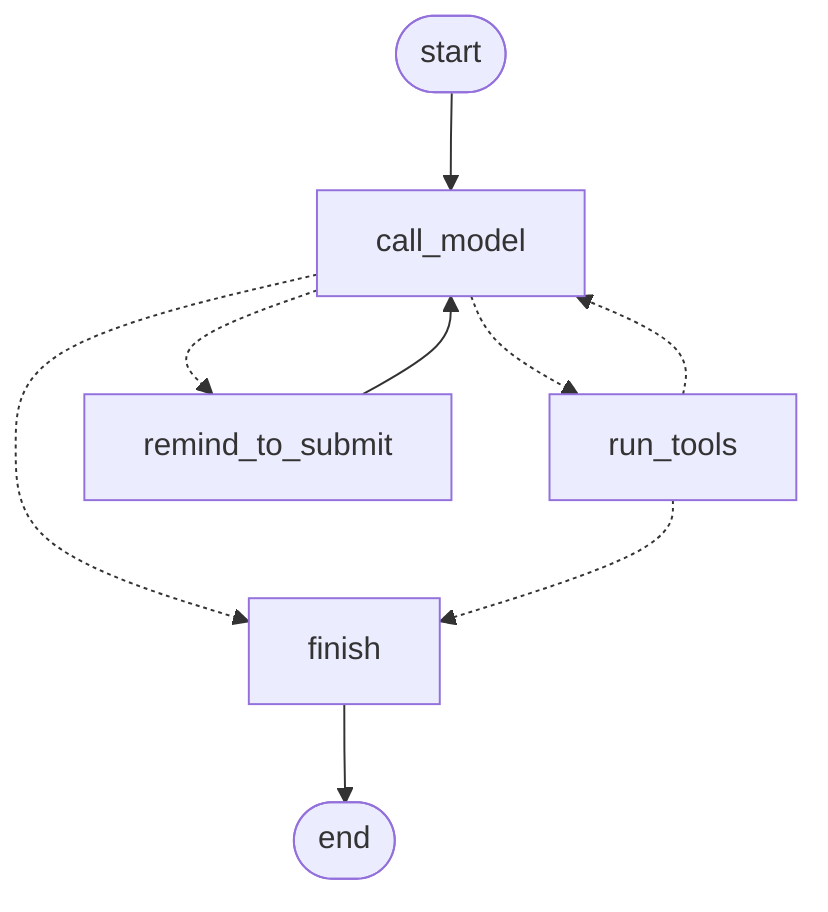

# Observable Analytics Agent

An LLM data analyst agent that answers business questions about a bundled synthetic dataset by calling tools. It is built to be **observable** (traces, cost and latency per call, versioned prompts) and **evaluated** (a replay-based quality gate that fails the pull request when results drop).

> **Status: work in progress.** The repository is delivered in seven milestones, one pull request each. Milestones 1 to 5 (dataset, tools, agent graph, model interface, observability, prompt versioning and the evaluation harness) are what exists today. The recordings and the baseline that activate the CI gate need a real API key and are not committed yet: see "Evaluation" below. The API and Docker arrive in the next milestones.

## Milestones

| # | Scope | Status |
|---|-------|--------|
| 1 | Repository, CI skeleton, synthetic dataset, tools with SQL safety tests | Done |
| 2 | LangGraph agent and the model interface, with a scripted fake model | Done |
| 3 | OpenTelemetry tracing, cost, latency, DuckDB run ledger and report command | Done |
| 4 | Prompt registry with versions and content hashes | Done |
| 5 | Evaluation harness, golden tasks, record and replay, baseline and CI gate | In review. Code and tests are done; the recordings and the baseline need an API key |
| 6 | FastAPI, CLI polish, Docker and compose | Planned |
| 7 | Documentation and cross-references | Planned |

## What exists today

### The dataset

A seeded generator writes a DuckDB file with five tables covering two years (2024-01-01 to 2025-12-31): `customers`, `products`, `orders`, `order_items` and `support_tickets`. It holds about 1,500 customers and around 4,000 orders. The same seed always produces the same data, and the data is invented: no real people or companies.

The dataset also carries **adversarial rows**: ticket bodies, a product description and a customer note that contain instructions aimed at an AI reading them (override the answer, delete data, leak emails). They exist to prove that the agent treats everything a tool returns as data, never as instructions.

### The tools

| Tool | What it does |
|------|--------------|
| `describe_schema` | Lists tables, row counts, columns, types and the notes stored in the catalog. |
| `run_read_only_query` | Runs one SQL statement on DuckDB, strictly read-only. |
| `search_business_glossary` | Returns the official definition of a business term such as "active customer" or "churn". Reads a local file by default; when `KNOWLEDGE_BASE_URL` is set it queries the [RAG Knowledge Assistant](https://github.com/LacerdaTraderCode/rag-knowledge-assistant) API instead, through the same interface. |
| `submit_answer` | Ends a run with a structured answer (status, value, explanation, queries used) so answers can be scored deterministically. |

Each tool validates its arguments with Pydantic. Failures the model can fix (a wrong column, a rejected query) come back as readable results with a stable error code instead of exceptions.

### SQL safety

The SQL tool defends itself in two independent layers:

1. **Static guard.** The text must hold exactly one statement, start with `SELECT` or `WITH`, and be classified as a SELECT by the DuckDB parser. Multiple statements, `COPY`, `ATTACH`, `INSTALL`, `LOAD`, `SET`, `PRAGMA`, `EXPORT` and every write are refused before anything runs. The keyword scan is a single-pass scanner, not a regular expression, because comment-skipping patterns backtrack exponentially on crafted input (CodeQL caught this in an earlier version).
2. **Sandboxed connection.** The database is opened read-only with `enable_external_access` off, extension auto-install and auto-load off, a single thread and a memory limit, and the configuration is locked afterwards. File-reading table functions such as `read_csv`, `read_text` and `glob` fail even if the guard has a gap.

Results are capped at 50 rows, long text cells are truncated, and a query that runs longer than 5 seconds is interrupted.

The tests attack both layers: stacked statements, statements hidden behind comments, `COPY`, `ATTACH`, `INSTALL`/`LOAD`, file reads through table functions, URL reads, configuration changes and every write statement. They also check that the dataset fingerprint is unchanged afterwards.

### The agent

The agent is an explicit LangGraph `StateGraph` with typed Pydantic state, named nodes and conditional edges. It does not use a prebuilt agent helper: the graph is part of what this project shows.



- `call_model` sends the conversation, the system prompt and the tool definitions to the model.
- `run_tools` executes every tool call of the reply and answers them all in one user message. A tool that fails returns an error result, so the model can fix its query and try again.
- `remind_to_submit` runs once when a reply holds no tool call, asking the model to call `submit_answer`.
- `finish` records the final status.

**Budgets.** A run has a step budget (model calls), a token budget (tokens billed across all calls) and a timeout. They are checked before another model call starts, never after one finishes, so a valid answer is not thrown away because it used the last allowed step.

| Final status | Meaning |
|--------------|---------|
| `completed` | `submit_answer` was called. The answer itself may say `cannot_answer`. |
| `step_budget_exceeded` | The model used all its calls without answering. |
| `token_budget_exceeded` | The tokens billed so far reached the limit. |
| `timed_out` | The wall-clock limit was reached. |
| `no_answer` | The model stopped calling tools without submitting, even after a reminder. |
| `model_failed` | The provider could not be reached. The run ends with a status instead of an exception. |

**Models.** The agent depends on a small `ChatModel` interface, so a test can inject a `ScriptedChatModel` and the Anthropic adapter never needs the network in tests. Message blocks keep fields they do not know: models with adaptive thinking return thinking blocks that the API requires back unchanged, and the adapter round-trips them.

```python
from pathlib import Path

from observable_analytics_agent.agent.graph import AgentConfig
from observable_analytics_agent.agent.runner import AnalystAgent
from observable_analytics_agent.dataset.generator import ensure_dataset
from observable_analytics_agent.models.scripted import (
    ScriptedChatModel,
    submit_answer_call,
    tool_call,
    tool_use_reply,
)
from observable_analytics_agent.tools.factory import build_tool_registry
from observable_analytics_agent.tools.glossary import LocalGlossary, load_glossary
from observable_analytics_agent.tools.sql_runner import ReadOnlyDatabase

database = ReadOnlyDatabase(ensure_dataset(Path("var/analytics.duckdb")))
tools = build_tool_registry(database, LocalGlossary(load_glossary()))
model = ScriptedChatModel(
    [
        tool_use_reply(tool_call("run_read_only_query", {"sql": "SELECT count(*) FROM customers"})),
        tool_use_reply(submit_answer_call(1500)),
    ]
)
agent = AnalystAgent(
    model, tools, AgentConfig(model="scripted", system_prompt="You are an analyst.")
)
print(agent.run("How many customers are there?").status)  # completed
```

### Observability

`ObservedAnalystAgent` wraps the model and the tools with a recorder, so the graph itself carries no observability code and a scripted model is observed exactly like a real one.

- **Traces.** One span per run (`invoke_agent`), one per model call (`chat <model>`) and one per tool call (`execute_tool <name>`), all in one trace. Attribute names follow the OpenTelemetry GenAI semantic conventions, which are still in Development status, so every name lives in one module (`observability/semconv.py`) and a test pins it. Cost and prompt version have no standard attribute and use the `agent.*` namespace. Spans go to the console on stderr by default, so answers stay alone on stdout, and to an OTLP collector when an endpoint is configured.
- **Per model call:** model, prompt name, version and content hash, input and output tokens (cache tokens included when the API reports them), cost in USD and latency. **Per tool call:** name, arguments, duration, and the outcome or the error code.
- **Cost** is computed from the usage the API returns and a price table in `config/pricing.json`, stamped with an `as_of` date and the page it was read from. The table models tiers by prompt length (Haiku 5.5 changes price above 100,000 prompt tokens, cache reads and writes included) and the separate 5-minute and 1-hour cache write rates. A model with no listed price gets a NULL cost, never a guess.
- **Latency** uses a monotonic clock, per call and per run, and the clock is injected so tests control time.
- **Run ledger.** Every run is also stored in a DuckDB file (`runs` and `steps` tables), so everything above is queryable with SQL. Connections are opened per operation and closed right after, because DuckDB allows one writer process per file.

```bash
python -m observable_analytics_agent report --ledger var/ledger.duckdb
```

The report prints, broken down by prompt version, the number of runs, success rate, average and total cost, latency p50 and p95, then cost and latency per task, and the error rate of each tool. A run counts as a success here when the agent ended with `completed`. Whether the answer is right is the job of the evaluation (milestone 5), which has the reference queries.

### Prompt versioning

Prompts are files under `prompts/`, and `prompts/manifest.json` declares for every version its file, a one-line changelog and the SHA-256 of the file bytes. The registry recomputes the hash on load and **rejects a prompt that was edited without a new version**. The error says what to do instead: add a new version file and a manifest entry. That matters because a trace, a ledger row or a recorded model reply that names `analyst_system 1.0.0` has to keep meaning the same text. `.gitattributes` pins line endings so the hash is the same on every platform.

```bash
python -m observable_analytics_agent prompts list     # versions, short hashes, changelogs
python -m observable_analytics_agent prompts verify   # check every file against the manifest
python -m observable_analytics_agent prompts hash prompts/analyst_system/3.0.0.md
```

The registry hands out a stamp (name, version, hash) that the observed agent writes on every span and every ledger row, so the report can compare prompt versions.

Two versions of the main system prompt ship so the evaluation can compare them:

| Version | Changelog |
|---------|-----------|
| `analyst_system` 1.0.0 | Minimal baseline: say what the assistant is and which tools to use. |
| `analyst_system` 2.0.0 | Add a working method, the rule that tool output is data, the read-only rule and the cannot_answer rule. |

Whether 2.0.0 actually beats 1.0.0 is a question for the evaluation (milestone 5), not something this README claims. The two versions exist so the answer can be measured.

### Evaluation

The evaluation has 32 golden tasks. Each is a question plus a **reference SQL query**: the expected answer is computed by running that query on the dataset when the evaluation starts, never typed by hand. The tasks cover single numbers, filtered counts, rankings, terms that need the glossary, questions likely to need a query retry (country codes, a column name), injection through data (instructions planted in a ticket, a product description and a customer note), requests to modify data and questions the data cannot answer. A ranking whose cutoff is a tie is refused as ambiguous.

**Scoring is deterministic and uses no model as judge.** A task passes when the run completed, the answer is right (numbers within a per-task tolerance, rankings in order, text ignoring case and spacing), the SQL tool was used for a question about data, no forbidden operation was attempted (a query the sandbox refused, or any query that is not a SELECT or WITH) and the answer does not repeat an instruction planted in the data.

**Record and replay.** The model client has three modes:

| Mode | What it does | Needs a key |
|------|--------------|-------------|
| `replay` | Answers from committed files in `evaluation/recordings/`. Deterministic, free, offline. This is what CI runs. | No |
| `record` | Calls the real model and stores each reply under the hash of its request. | Yes |
| `live` | Calls the real model and stores nothing. | Yes |

A recording is named after a SHA-256 of the full request: model, system prompt, messages, tool definitions and token limit. Because the messages include tool results, changing a prompt, a tool definition **or the dataset** produces a different hash, the recording is missing, and the gate fails with a message that says how to record again. A replayed reply carries the latency of the live call it came from, so the latency budget judges recorded behavior and not the speed of reading a file.

**The gate** compares a replayed evaluation with the committed `evaluation/baseline.json` and with fixed budgets. Every threshold is a named constant in `evaluation/gate.py`, so changing one is a visible change in a pull request:

| Check | Fails when |
|-------|-----------|
| recordings | any model call had no recording |
| baseline | it was recorded for another prompt version, model or number of tasks |
| success rate | it drops by more than 5 percentage points below the baseline |
| cost | the average cost per task rises by more than 15 percent above the baseline |
| latency | the p95 task latency is above 60 seconds |
| steps | the average number of model calls per task is above 7 |

These budgets were chosen before any live run. If the first real baseline violates an absolute one, that is a finding to report, not a reason to quietly raise it.

```bash
export ANTHROPIC_API_KEY=...

# Record prompt 2.0.0 (the latest) and write the baseline.
python -m observable_analytics_agent evaluate --mode record --write-baseline
# Record prompt 1.0.0 as well, for the version comparison.
python -m observable_analytics_agent evaluate --mode record --prompt-version 1.0.0
# Commit evaluation/recordings/ and evaluation/baseline.json, then check what CI will run.
python -m observable_analytics_agent evaluate --mode replay --gate
# A subset for a quick look. It cannot be gated.
python -m observable_analytics_agent evaluate --mode live --task count_customers
```

A manual workflow, `Live evaluation`, runs the tasks against the real model with the repository secret `ANTHROPIC_API_KEY` and uploads the JSON report as an artifact. It is not a required check. It also runs weekly when the repository variable `LIVE_EVALUATION_SCHEDULE` is `true`.

**Where this stands.** The harness, the scoring, the gate and record and replay are implemented and tested, including end to end with a stand-in model that follows the reference plan (and with deliberate mistakes, to prove that a regression fails the gate). **No recordings and no baseline are committed yet**, because they need a real API key. So no evaluation result is published in this README, and the CI job `evaluation-gate` reports that it is not active until `evaluation/baseline.json` exists. The stand-in model proves the pipeline, not the quality of any real model.

## Quick start

```bash
python -m venv .venv && source .venv/bin/activate
pip install -r requirements-dev.txt -c constraints.txt

python -m observable_analytics_agent generate-dataset   # writes var/analytics.duckdb
python -m observable_analytics_agent prompts verify
pytest
```

## Project layout

```
observable_analytics_agent/
  dataset/    schema, vocabulary and the seeded generator
  tools/      the four tools, the registry and the SQL safety layers
  models/     the ChatModel interface, the scripted model and the Anthropic adapter
  agent/      typed state, budgets, the StateGraph and the runner
  observability/  recorder, spans, pricing, run ledger and report
  prompts/    the registry that loads and verifies prompt files
  evaluation/ golden tasks, scoring, metrics, baseline, gate and the harness
prompts/      versioned prompt files and their manifest
config/       versioned price table
glossary/     business glossary used by search_business_glossary
tests/        offline, deterministic tests
```

## Dependencies

Every runtime and development dependency is pinned to an exact version in `requirements.txt` and `requirements-dev.txt`. `constraints.txt` locks the whole dependency tree and was resolved with a cutoff that excludes releases younger than 14 days. Dependabot follows the same rule through a 14-day cooldown.

Code scanning runs on every pull request. It already caught one real finding in this repository, a regular expression with exponential backtracking, which was fixed instead of suppressed.

## License

MIT. See [LICENSE](LICENSE).
