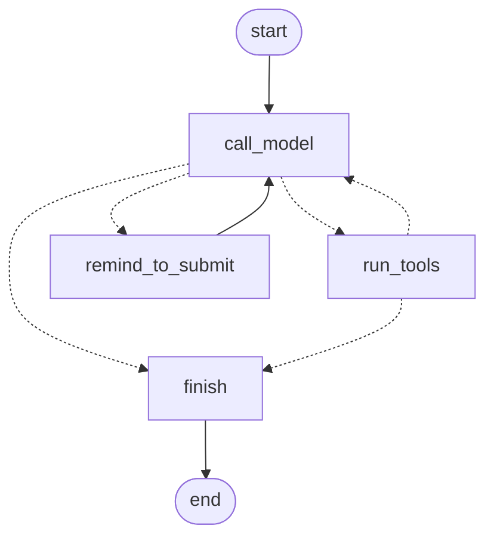

# Observable Analytics Agent

An LLM data analyst agent that answers business questions about a bundled synthetic dataset by calling tools. It is built to be **observable** (traces, cost and latency per call, versioned prompts) and **evaluated** (a replay-based quality gate that fails the pull request when results drop).

> **Status: work in progress.** The repository is delivered in seven milestones, one pull request each. Milestones 1 to 4 (dataset, tools, agent graph, model interface, observability and prompt versioning) are what exists today. Evaluation, API and Docker arrive in the next milestones, and this README grows with them.

## Milestones

| # | Scope | Status |
|---|-------|--------|
| 1 | Repository, CI skeleton, synthetic dataset, tools with SQL safety tests | Done |
| 2 | LangGraph agent and the model interface, with a scripted fake model | Done |
| 3 | OpenTelemetry tracing, cost, latency, DuckDB run ledger and report command | In review |
| 4 | Prompt registry with versions and content hashes | Planned |
| 5 | Evaluation harness, golden tasks, record and replay, baseline and CI gate | Planned |
| 6 | FastAPI, CLI polish, Docker and compose | Planned |
| 7 | Documentation and cross-references | Planned |

## What exists today

### The dataset

A seeded generator writes a DuckDB file with five tables covering two years (2024-01-01 to 2025-12-31): `customers`, `products`, `orders`, `order_items` and `support_tickets`. It holds about 1,500 customers and around 4,000 orders. The same seed always produces the same data, and the data is invented: no real people or companies.

The dataset also carries **adversarial rows**: ticket bodies, a product description and a customer note that contain instructions aimed at an AI reading them (override the answer, delete data, leak emails). They exist to prove that the agent treats everything a tool returns as data, never as instructions.

### The tools

| Tool | What it does |
|------|--------------|
| `describe_schema` | Lists tables, row counts, columns, types and the notes stored in the catalog. |
| `run_read_only_query` | Runs one SQL statement on DuckDB, strictly read-only. |
| `search_business_glossary` | Returns the official definition of a business term such as "active customer" or "churn". Reads a local file by default; when `KNOWLEDGE_BASE_URL` is set it queries the [RAG Knowledge Assistant](https://github.com/LacerdaTraderCode/rag-knowledge-assistant) API instead, through the same interface. |
| `submit_answer` | Ends a run with a structured answer (status, value, explanation, queries used) so answers can be scored deterministically. |

Each tool validates its arguments with Pydantic. Failures the model can fix (a wrong column, a rejected query) come back as readable results with a stable error code instead of exceptions.

### SQL safety

The SQL tool defends itself in two independent layers:

1. **Static guard.** The text must hold exactly one statement, start with `SELECT` or `WITH`, and be classified as a SELECT by the DuckDB parser. Multiple statements, `COPY`, `ATTACH`, `INSTALL`, `LOAD`, `SET`, `PRAGMA`, `EXPORT` and every write are refused before anything runs. The keyword scan is a single-pass scanner, not a regular expression, because comment-skipping patterns backtrack exponentially on crafted input (CodeQL caught this in an earlier version).
2. **Sandboxed connection.** The database is opened read-only with `enable_external_access` off, extension auto-install and auto-load off, a single thread and a memory limit, and the configuration is locked afterwards. File-reading table functions such as `read_csv`, `read_text` and `glob` fail even if the guard has a gap.

Results are capped at 50 rows, long text cells are truncated, and a query that runs longer than 5 seconds is interrupted.

The tests attack both layers: stacked statements, statements hidden behind comments, `COPY`, `ATTACH`, `INSTALL`/`LOAD`, file reads through table functions, URL reads, configuration changes and every write statement. They also check that the dataset fingerprint is unchanged afterwards.

### The agent

The agent is an explicit LangGraph `StateGraph` with typed Pydantic state, named nodes and conditional edges. It does not use a prebuilt agent helper: the graph is part of what this project shows.



- `call_model` sends the conversation, the system prompt and the tool definitions to the model.
- `run_tools` executes every tool call of the reply and answers them all in one user message. A tool that fails returns an error result, so the model can fix its query and try again.
- `remind_to_submit` runs once when a reply holds no tool call, asking the model to call `submit_answer`.
- `finish` records the final status.

**Budgets.** A run has a step budget (model calls), a token budget (tokens billed across all calls) and a timeout. They are checked before another model call starts, never after one finishes, so a valid answer is not thrown away because it used the last allowed step.

| Final status | Meaning |
|--------------|---------|
| `completed` | `submit_answer` was called. The answer itself may say `cannot_answer`. |
| `step_budget_exceeded` | The model used all its calls without answering. |
| `token_budget_exceeded` | The tokens billed so far reached the limit. |
| `timed_out` | The wall-clock limit was reached. |
| `no_answer` | The model stopped calling tools without submitting, even after a reminder. |
| `model_failed` | The provider could not be reached. The run ends with a status instead of an exception. |

**Models.** The agent depends on a small `ChatModel` interface, so a test can inject a `ScriptedChatModel` and the Anthropic adapter never needs the network in tests. Message blocks keep fields they do not know: models with adaptive thinking return thinking blocks that the API requires back unchanged, and the adapter round-trips them.

```python
from pathlib import Path

from observable_analytics_agent.agent.graph import AgentConfig
from observable_analytics_agent.agent.runner import AnalystAgent
from observable_analytics_agent.dataset.generator import ensure_dataset
from observable_analytics_agent.models.scripted import (
    ScriptedChatModel,
    submit_answer_call,
    tool_call,
    tool_use_reply,
)
from observable_analytics_agent.tools.factory import build_tool_registry
from observable_analytics_agent.tools.glossary import LocalGlossary, load_glossary
from observable_analytics_agent.tools.sql_runner import ReadOnlyDatabase

database = ReadOnlyDatabase(ensure_dataset(Path("var/analytics.duckdb")))
tools = build_tool_registry(database, LocalGlossary(load_glossary()))
model = ScriptedChatModel(
    [
        tool_use_reply(tool_call("run_read_only_query", {"sql": "SELECT count(*) FROM customers"})),
        tool_use_reply(submit_answer_call(1500)),
    ]
)
agent = AnalystAgent(
    model, tools, AgentConfig(model="scripted", system_prompt="You are an analyst.")
)
print(agent.run("How many customers are there?").status)  # completed
```

### Observability

`ObservedAnalystAgent` wraps the model and the tools with a recorder, so the graph itself carries no observability code and a scripted model is observed exactly like a real one.

- **Traces.** One span per run (`invoke_agent`), one per model call (`chat <model>`) and one per tool call (`execute_tool <name>`), all in one trace. Attribute names follow the OpenTelemetry GenAI semantic conventions, which are still in Development status, so every name lives in one module (`observability/semconv.py`) and a test pins it. Cost and prompt version have no standard attribute and use the `agent.*` namespace. Spans go to the console on stderr by default, so answers stay alone on stdout, and to an OTLP collector when an endpoint is configured.
- **Per model call:** model, prompt name, version and content hash, input and output tokens (cache tokens included when the API reports them), cost in USD and latency. **Per tool call:** name, arguments, duration, and the outcome or the error code.
- **Cost** is computed from the usage the API returns and a price table in `config/pricing.json`, stamped with an `as_of` date and the page it was read from. The table models tiers by prompt length (Haiku 5.5 changes price above 100,000 prompt tokens, cache reads and writes included) and the separate 5-minute and 1-hour cache write rates. A model with no listed price gets a NULL cost, never a guess.
- **Latency** uses a monotonic clock, per call and per run, and the clock is injected so tests control time.
- **Run ledger.** Every run is also stored in a DuckDB file (`runs` and `steps` tables), so everything above is queryable with SQL. Connections are opened per operation and closed right after, because DuckDB allows one writer process per file.

```bash
python -m observable_analytics_agent report --ledger var/ledger.duckdb
```

The report prints, broken down by prompt version, the number of runs, success rate, average and total cost, latency p50 and p95, then cost and latency per task, and the error rate of each tool. A run counts as a success here when the agent ended with `completed`. Whether the answer is right is the job of the evaluation (milestone 5), which has the reference queries.

## Quick start

```bash
python -m venv .venv && source .venv/bin/activate
pip install -r requirements-dev.txt -c constraints.txt

python -m observable_analytics_agent generate-dataset   # writes var/analytics.duckdb
pytest
```

## Project layout

```
observable_analytics_agent/
  dataset/    schema, vocabulary and the seeded generator
  tools/      the four tools, the registry and the SQL safety layers
  models/     the ChatModel interface, the scripted model and the Anthropic adapter
  agent/      typed state, budgets, the StateGraph and the runner
  observability/  recorder, spans, pricing, run ledger and report
config/       versioned price table
glossary/     business glossary used by search_business_glossary
tests/        offline, deterministic tests
```

## Dependencies

Every runtime and development dependency is pinned to an exact version in `requirements.txt` and `requirements-dev.txt`. `constraints.txt` locks the whole dependency tree and was resolved with a cutoff that excludes releases younger than 14 days. Dependabot follows the same rule through a 14-day cooldown.

Code scanning runs on every pull request. It already caught one real finding in this repository, a regular expression with exponential backtracking, which was fixed instead of suppressed.

## License

MIT. See [LICENSE](LICENSE).
